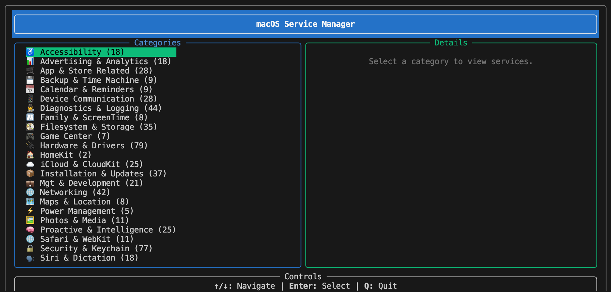
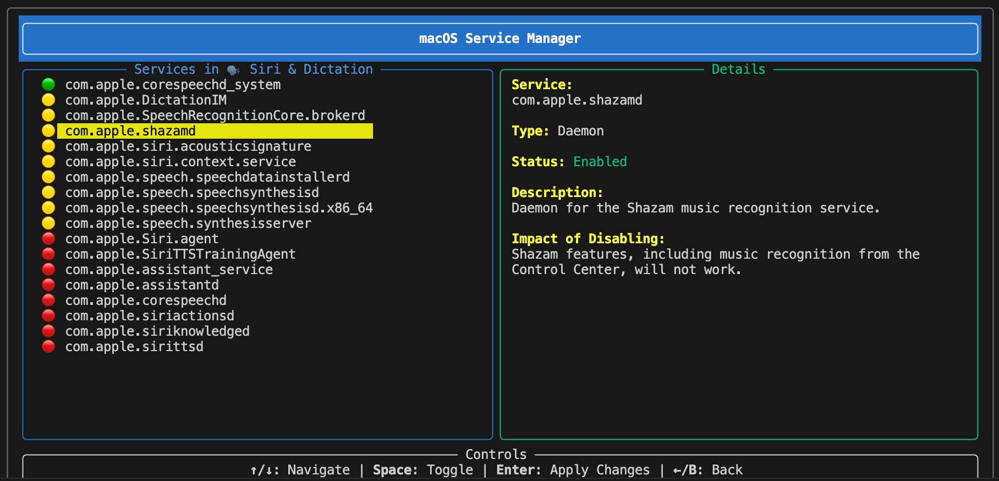
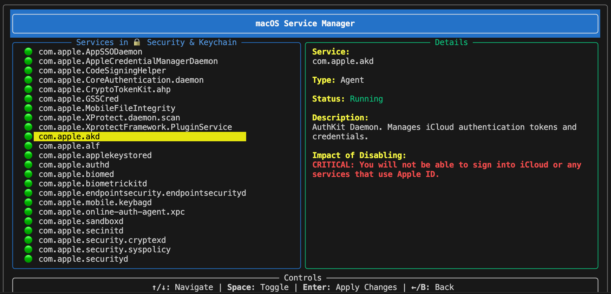

# macos-service-manager

## Description

This is a simple service manager for macOS that allows you to start, stop, and restart services. It is designed to be easy to use and provides a straightforward way to manage services on your macOS system.

## Screenshots

**Service categories**


**Running, Enabled, and Disabled Services**


**Service Details & Critical Services**


## Features

- Start, stop, and restart services
- List all available services
- Check the status of services
- User-friendly TUI (Text User Interface)

## Requirements

- Python 3.x

## Installation

1. Disable **SIP (System Integrity Protection)** on your macOS system. This is necessary to allow the script to manage system services. You can find instructions on how to disable SIP [here](https://support.apple.com/en-us/HT201560).
2. Clone the repository:

```bash
git clone https://github.com/bright-and-early/macos-service-manager.git
```

3. Navigate to the project directory:

```bash
cd macos-service-manager
```

4. Create a virtual environment and install the required dependencies:

```bash
python3 -m venv .venv
.venv/bin/pip install -r requirements.txt
```

5. Run the service manager (it needs root to manage system services, so point `sudo` at the virtual environment's interpreter):

```bash
sudo .venv/bin/python3 manage-services.tui.py
```

## Applying changes

Select a service, press **Space** to toggle its pending enabled/disabled state,
then press **Enter** and confirm with **y**. Disabling first records the persistent
launchd override, then unloads the job from its discovered domain (`system`,
`gui/<uid>`, or `user/<uid>`). The manager verifies both results before reporting
success. Errors remain visible until you press a key; a rescan shows actual state.
Enabling removes the disabled override; it does not immediately load or start
an unloaded service. The service can load again at login/reboot or through its
normal launch mechanism.

The list contains services and overrides discovered on this Mac. The description
database supplies metadata and does not prove that a service is installed.
Services sharing a label across domains appear separately with their domains.
macOS can reject changes to protected services; the manager displays that error.

Run regression tests with:

```bash
.venv/bin/python -m unittest discover -s tests -v
```

An optional live smoke check creates a disposable user agent, disables/unloads it,
verifies enabling and reloading, then removes its job and temporary plist (an
enabled override for the test label remains):

```bash
.venv/bin/python tests/live_service_check.py
```

Recorded live verification: [launchctl smoke check](artifacts/launchctl-smoke-check.svg).
